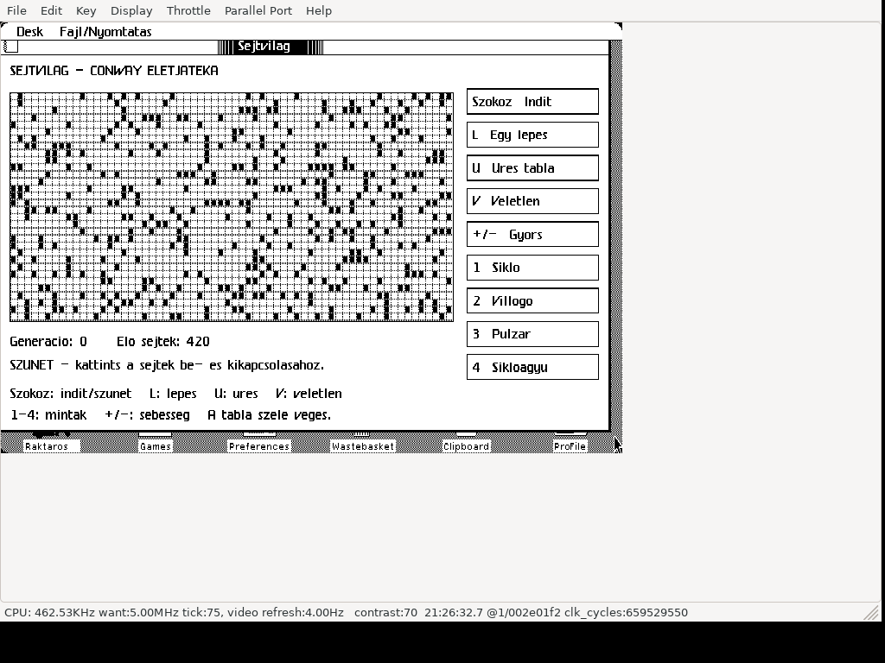

# Sejtvilág — Conway Game of Life for Apple Lisa 2

**Native Motorola 68000 application for real Apple Lisa 2 hardware running
Lisa Office System 3 / 3.1.** LisaEm is also supported. This is a native LOS
application, intended for Lisa 2/5 and 2/10; it is not a browser recreation.

Hungarian interactive cellular automaton: editable 64×32 finite grid, B3/S23 rules,
run/pause, stepping, speed selection, glider, blinker, pulsar and Gosper glider gun.
Captions use unaccented Hungarian for the Lisa font.

## Download and run

Download **[Sejtvilag.dc42](https://github.com/julyus7/lisa-sejtvilag/releases/latest/download/Sejtvilag.dc42)**,
or [dist/Sejtvilag.dc42](dist/Sejtvilag.dc42) using Download raw.
The tagged Disk Copy 4.2 image is **419284 bytes**, a Lisa 400 KB application
floppy with one visible launch icon. Boot your own LOS installation first.

### Real Apple Lisa 2

1. Boot your Lisa 2 into Lisa Office System.
2. Write the complete DC42 to a Lisa-format 400 KB 3.5-inch floppy using a
   compatible writer/drive that preserves native Lisa sector tags, or use a
   compatible floppy replacement supporting native Lisa disk images.
3. Open the floppy window, select **Sejtvilag**, then **File/Print → Open**.

Copying the DC42 file onto an ordinary formatted floppy is not image writing.
Hard-disk installation uses LOS Duplicate followed by moving the duplicate
into the destination folder; keep the floppy inserted until copying finishes.
This release's recorded tests cover floppy launch, **not hard-disk installation**.

### LisaEm

Boot your own LOS, mount the DC42 and open its tool. Use **Key → ASCII Keyboard**.
If the app is a set-aside, inactive window, double-click it to resume it before typing.
The slow Linux/QEMU test host used `forcerefresh=1` and Display → Refresh Rate →
4 Hz for faithful X11 capture. Set persistent preferences with LisaEm closed;
the floppy does not change emulator settings. Real hardware has no host cache.

Tool ID **246**, custom icon, volume identity **D607**. Tested floppy launch
alongside 20 existing tool IDs; their 77 program/resource files stayed unchanged.
LOS permits one copy of a tool per disk; replace an earlier version when updating.

## Controls and rules

Click to toggle a cell (pauses); Space run/pause; L step; U clear; V random;
1–4 patterns; +/− speed; Escape pause. The boundary is dead and does not wrap.
Unchanged states stop automatically; oscillators continue.

See [Hungarian instructions](README-HU.md).

## Build and validation

Compiled natively with Lisa Pascal 3.26, MC68000 Code Generator 3.16 and
Lisa Linker 3.0 (zero linker errors). See [BUILD.md](BUILD.md).
Recorded Linux LisaEm / LOS 3.1 / 1 MB checks: **67 native
checks and 605 independent model checks**.
An additional 81 X11 frames checked sampled static regions and visible animation.
**Physical Lisa 2, Windows LisaEm and a separate LOS 3.0 run remain untested.**
Hardware is the intended native target; emulator results are not hardware measurements.
See [VALIDATION.md](VALIDATION.md), [validation reports](validation/) and
[CREDITS.md](CREDITS.md). ROMs, LOS/Workshop images, proprietary SDK libraries,
private VM images and credentials are not distributed.
